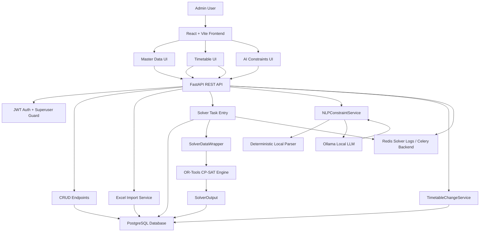
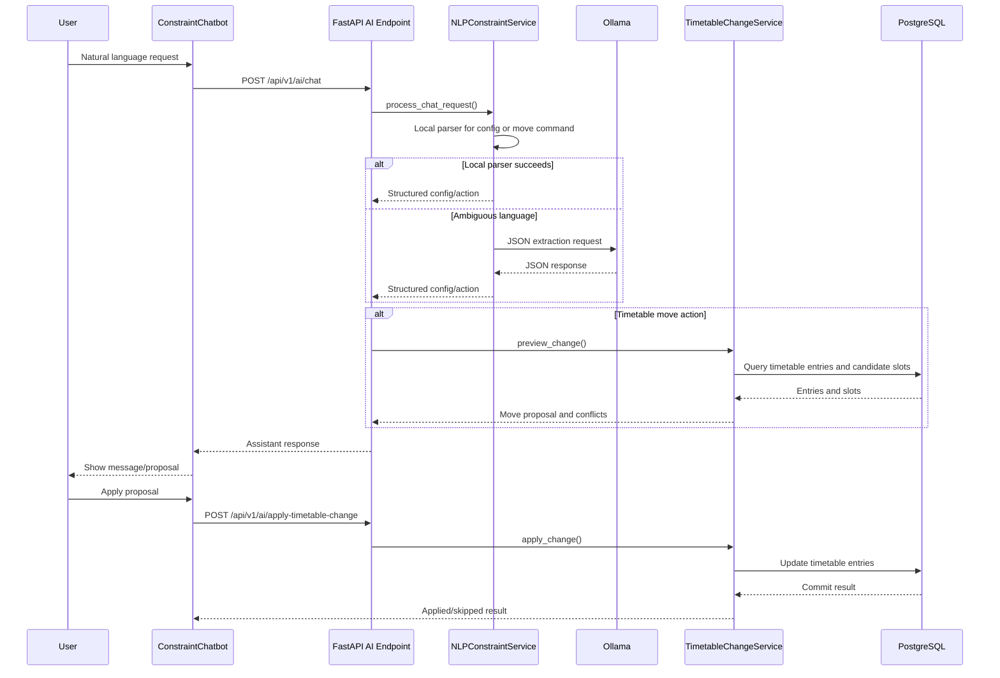
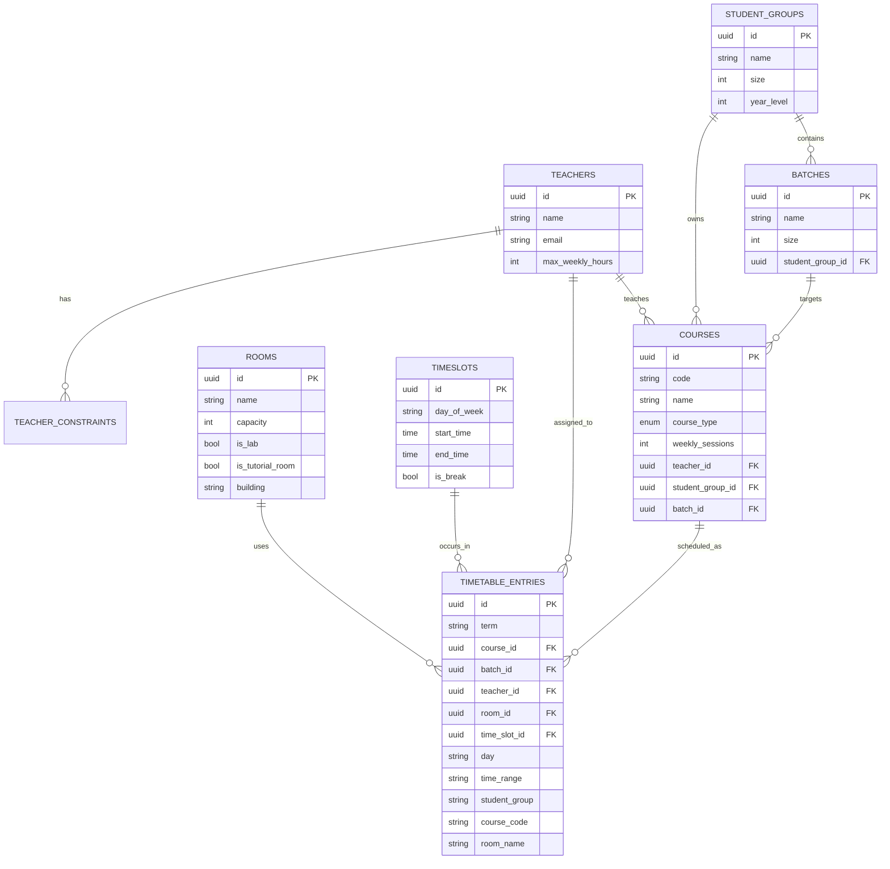

# IEEE-Style Research Paper Draft: AI-Enabled Constraint-Based Timetable Generation System

**Title:** Design and Implementation of an AI-Enabled Constraint-Based Timetable Generation System Using CP-SAT Optimization and Local LLM Assistance

**Author(s):** _Add student names here_  
**Affiliation:** _Add department, institute, university_  
**Contact:** _Add email address_

---

## Abstract

Educational timetable generation is a constrained combinatorial optimization problem involving teachers, divisions, batches, rooms, course types, availability constraints, and institutional scheduling rules. Manual timetable preparation is time-consuming and error-prone because a single change can create cascading conflicts across faculty workload, classroom capacity, laboratory availability, and student group schedules. This paper presents an AI-enabled timetable generation system that combines a web-based data management interface, a PostgreSQL relational database, a FastAPI backend, an OR-Tools CP-SAT optimization engine, and an Ollama-powered local natural language assistant. The system converts institutional master data into structured scheduling variables, enforces hard constraints such as teacher, room, batch, and division conflicts, and optimizes soft constraints such as reduced gaps, compact student schedules, daily teacher load, consecutive laboratory slots, and parallel laboratory alignment. The AI assistant supports natural language configuration and controlled timetable modification through deterministic parsing and local LLM-based JSON extraction. The proposed system demonstrates a practical architecture for explainable, configurable, and locally deployable timetable automation.

**Keywords:** Timetable generation, CP-SAT, constraint programming, OR-Tools, FastAPI, PostgreSQL, React, Ollama, local LLM, scheduling optimization, educational ERP.

---

## I. Introduction

Timetable generation in academic institutions requires assigning each course session to a valid day, time slot, room, teacher, and student entity while satisfying multiple operational rules. A feasible timetable must prevent teacher clashes, room double-booking, batch overlaps, and theory-lab conflicts. A high-quality timetable must also reduce long idle gaps for students, control teacher workload, keep laboratories consecutive, and avoid scattered schedules.

The implemented project is a full-stack timetable automation system named **AI Timetable Generator**. It provides:

1. Master data entry for teachers, rooms, student groups, batches, courses, breaks, and availability constraints.
2. Excel load-distribution import for institution-specific workload files.
3. A CP-SAT solver that generates feasible and quality-aware timetables.
4. Persistent timetable storage in PostgreSQL.
5. A web frontend for viewing, exporting, and regenerating timetables.
6. A local AI assistant using Ollama for natural language configuration and timetable change requests.

The major design goal is to combine deterministic optimization with controlled AI assistance. The solver remains responsible for feasibility and correctness, while the AI assistant only converts human language into structured configuration updates or safe timetable move proposals.

---

## II. Problem Statement

Given a set of teachers, courses, student groups, batches, rooms, and time slots, the system must generate a weekly timetable such that every required teaching session is assigned to one valid time slot and one valid room.

The problem is difficult because:

1. A teacher cannot teach more than one session at the same time.
2. A room cannot host more than one session at the same time.
3. A student group cannot attend two theory sessions simultaneously.
4. A batch cannot attend two lab or tutorial sessions simultaneously.
5. A batch session cannot overlap with a whole-division theory session.
6. Room capacity and room type must match the course requirement.
7. Laboratory and tutorial sessions should be placed in consecutive blocks when required.
8. Student schedules should avoid long internal gaps.
9. Teacher schedules should avoid excessive daily load.
10. Imported academic load data can be incomplete, inconsistent, or over-constrained.

Therefore, the project models timetable generation as a constraint satisfaction and optimization problem.

---

## III. System Requirements

### A. Functional Requirements

The system supports the following functional requirements:

1. User authentication and protected administrative access.
2. CRUD operations for teachers, courses, rooms, student groups, batches, and breaks.
3. Excel-based workload import from institutional load distribution files.
4. Reset operation for master data and generated timetable data.
5. Automatic timetable generation for a selected academic term.
6. Real-time solver logs displayed in the timetable page console.
7. Storage and retrieval of generated timetables by term.
8. CSV export of timetable results.
9. Natural language assistant for soft constraint updates.
10. Preview and apply flow for timetable move requests.

### B. Non-Functional Requirements

The non-functional requirements include:

1. **Correctness:** no teacher, room, group, or batch conflict should exist in saved feasible timetables.
2. **Explainability:** solver logs must show skipped courses, room capacity, demand, status, and failure reason.
3. **Local deployability:** AI functionality should work with local Ollama instead of depending on a remote LLM provider.
4. **Performance:** the solver should return within a configurable time limit.
5. **Maintainability:** frontend, API, solver, import, and AI services should remain separated by module boundaries.
6. **Recoverability:** if quality optimization times out, the backend should attempt a fallback solve with soft optimization disabled while keeping important hard constraints.

---

## IV. Technology Stack

| Layer | Technology | Role |
|---|---|---|
| Frontend | React 19, TypeScript, Vite | Single-page application |
| UI Styling | Tailwind CSS, Radix UI, lucide-react | Component styling and icons |
| HTTP Client | Axios | API communication |
| Backend API | FastAPI | REST endpoints and request validation |
| Validation | Pydantic | Request and response schemas |
| ORM | SQLAlchemy | Database models and queries |
| Database | PostgreSQL | Persistent relational storage |
| Worker | Celery | Optional asynchronous solver execution |
| Queue/Logs | Redis | Celery broker/result backend and solver logs |
| Solver | Google OR-Tools CP-SAT | Constraint programming optimization |
| AI Assistant | Ollama, llama3.1 | Local LLM-based JSON extraction |
| Spreadsheet Import | openpyxl | Excel load-distribution parsing |
| Testing | pytest, TypeScript build, ESLint | Verification |

---

## V. Technical System Architecture

The system follows a layered full-stack architecture. The frontend sends REST API requests to the backend. The backend validates input, reads and writes PostgreSQL data through SQLAlchemy, invokes the solver, and calls Ollama for natural language parsing when needed.



### A. Frontend Layer

The frontend is located under `frontend/src`. It provides:

1. `pages/DataEntry.tsx` for master data management and Excel import.
2. `pages/Timetables.tsx` for generation, solver console logs, timetable display, and CSV export.
3. `pages/Constraints.tsx` for solver preference configuration and AI assistant interaction.
4. `components/ConstraintChatbot.tsx` for natural language messages, proposal preview, and apply actions.
5. `components/timetable/TimetableGrid.tsx` for timetable visualization.
6. `services/api.ts` for typed API wrappers around Axios.

### B. Backend Layer

The backend is located under `backend/app`. It provides:

1. `main.py`: FastAPI application setup and CORS configuration.
2. `api/api.py`: API router composition.
3. `api/endpoints/*.py`: endpoint modules for teachers, courses, rooms, breaks, imports, solver, and AI.
4. `models/*.py`: SQLAlchemy database models.
5. `schemas/*.py`: Pydantic request and response schemas.
6. `services/solver/*.py`: CP-SAT data wrapper, solver engine, and logging.
7. `services/llm/*.py`: Ollama client and natural language processing service.
8. `services/timetable_change_service.py`: timetable move preview and apply service.

### C. Database Layer

The database is PostgreSQL. SQLAlchemy models represent the academic domain and generated timetable output. The database acts as the source of truth for master data and saved timetable entries.

### D. AI Layer

The AI layer is local-first. The deterministic parser handles common timetable commands and soft constraint updates without LLM latency. Ollama is used only when the request is ambiguous or requires structured extraction from general language.

---

## VI. Low-Level System Pipeline

The complete system pipeline is shown below.


### A. Data Entry and Import Pipeline

The system accepts master data through manual UI forms and Excel import. The Excel import endpoint is:

`POST /api/v1/imports/load-distribution`

The import process:

1. Reads uploaded `.xlsx` or `.xlsm` files using `openpyxl`.
2. Validates that the first column represents faculty names.
3. Extracts teacher name and workload.
4. Parses theory, lab, and tutorial cells from fixed workbook columns.
5. Extracts subject names, divisions, batch counts, and weekly sessions.
6. Creates or updates teachers, student groups, batches, and courses.
7. Commits normalized records to PostgreSQL.

The reset endpoint is:

`DELETE /api/v1/imports/master-data`

It deletes timetable entries, courses, batches, student groups, teacher constraints, teachers, and global breaks in a dependency-safe order.

### B. Timetable Generation Pipeline

The generation endpoint is:

`POST /api/v1/solver/generate?term=Fall 2025`

The backend can run the solver inline for local development or through Celery if `SOLVER_ASYNC` is enabled.

Generation steps:

1. Fetch teachers, courses, rooms, student groups, and time slots.
2. Classify rooms into lecture, laboratory, and tutorial rooms.
3. Convert courses into allocation units.
4. Skip invalid records that do not have division, teacher, or batches.
5. Count session demand by course type.
6. Create CP-SAT variables for valid course-batch-room-slot combinations.
7. Add hard constraints.
8. Add soft optimization penalties if enabled.
9. Solve within `max_time_seconds`.
10. Save feasible entries into `timetable_entries`.
11. Return logs, diagnostics, status, score, and generated entries.

### C. AI Assistant Pipeline



The assistant is intentionally restricted. It does not directly rewrite arbitrary database rows from free text. It can:

1. Update soft solver preferences such as `max_daily_load`, `minimize_gaps`, `consecutive_labs`, and `parallel_labs`.
2. Parse group-day or teacher-day move requests.
3. Preview safe timetable changes before applying.
4. Apply only validated move proposals.

---

## VII. Database Design

### A. Entity Relationship Diagram



### B. Main Tables

The main database tables are:

1. `teachers`: faculty name, email, and weekly load.
2. `student_groups`: academic divisions such as FY, SY A, TY B, or BTECH.
3. `batches`: lab subdivisions such as b1, b2, and b3.
4. `courses`: subject allocation records with course type and weekly sessions.
5. `rooms`: lecture rooms, laboratory rooms, and tutorial rooms.
6. `timeslots`: day-wise hourly teaching slots and break markers.
7. `teacher_constraints`: teacher availability or unavailability windows.
8. `timetable_entries`: generated and saved timetable assignments.
9. `constraintlogs`: future training data for manual override learning.
10. `mlmodelartifacts`: metadata for future ML model artifacts.

---

## VIII. CP-SAT Solver Formulation

### A. Sets

Let:

- `C` be the set of courses.
- `B` be the set of batches, including `None` for theory courses.
- `T` be the set of teachers.
- `R` be the set of rooms.
- `S` be the set of time slots.
- `G` be the set of student groups or divisions.
- `D` be the set of teaching days.

### B. Decision Variable

The solver creates Boolean decision variables:

```text
x[c, b, t, r, s] in {0, 1}
```

where:

```text
x[c, b, t, r, s] = 1 if course c for batch b is taught by teacher t in room r at slot s
x[c, b, t, r, s] = 0 otherwise
```

For theory courses, `b = None`, because the whole student group attends the session. For laboratory and tutorial courses, `b` represents the target batch.

### C. Variable Creation Rules

A variable is created only if:

1. The room capacity is greater than or equal to the required student count.
2. A theory course uses a normal lecture room.
3. A lab course uses a lab room.
4. A tutorial course uses a tutorial room.
5. The course has a teacher and student group.
6. Lab or tutorial courses have at least one target batch.

This reduces the search space before CP-SAT solving begins.

### D. Hard Constraints

#### 1. Required Weekly Sessions

Each course unit must be scheduled exactly `weekly_sessions` times:

```text
sum_s slot_used[c, b, s] = weekly_sessions[c]
```

The helper variable `slot_used[c, b, s]` becomes active when any room is selected for that course unit at that slot.

#### 2. Single Room Per Course Unit Per Slot

A course unit cannot use multiple rooms in the same time slot:

```text
sum_r x[c, b, t, r, s] <= 1
```

#### 3. Teacher Conflict Constraint

A teacher cannot teach more than one session in the same slot:

```text
forall t, s:
sum_{c,b,r} x[c, b, t, r, s] <= 1
```

#### 4. Room Conflict Constraint

A room cannot contain more than one session in the same slot:

```text
forall r, s:
sum_{c,b,t} x[c, b, t, r, s] <= 1
```

#### 5. Batch Conflict Constraint

A batch cannot attend two sessions simultaneously:

```text
forall b, s:
sum_{c,t,r} x[c, b, t, r, s] <= 1
```

#### 6. Division Theory Conflict Constraint

A division cannot attend multiple theory classes simultaneously:

```text
forall g, s:
sum theory_sessions[g, s] <= 1
```

#### 7. Batch-Theory Synchronization Constraint

A batch cannot attend a lab or tutorial while its parent division has a theory class:

```text
forall b, s:
sum batch_sessions[b, s] + sum theory_sessions[parent_group(b), s] <= 1
```

#### 8. Teacher Availability Constraint

If a teacher has a busy or unavailable time window, every matching variable is forced to zero:

```text
if slot s lies inside unavailable_window(t):
    sum_{c,b,r} x[c, b, t, r, s] = 0
```

#### 9. Consecutive Laboratory/Tutorial Constraint

For lab and tutorial sessions that require multi-hour blocks, each active slot must have a direct previous or next neighbor on the same day:

```text
slot_used[c,b,s] <= slot_used[c,b,previous(s)] + slot_used[c,b,next(s)]
```

The system also enforces same-room continuity for consecutive lab/tutorial blocks:

```text
x[c,b,t,r,s] <= x[c,b,t,r,previous(s)] + x[c,b,t,r,next(s)]
```

#### 10. Maximum Internal Gap Constraint

For each division and day, if two active slots surround a large empty span, the middle span must contain enough active slots so that total internal gap does not exceed `max_group_gap_hours`.

Conceptually:

```text
if active[i] = 1 and active[j] = 1 and j - i - 1 > max_gap:
    require enough active slots between i and j
```

This prevents patterns such as a class at 10:00 and another at 15:00 with four hours of idle time.

#### 11. Early Activity Constraint

If a division has a class after the early teaching window, it must also have at least one early class. This avoids late-only days:

```text
active[j] <= active[0] + active[1] + active[2], for j >= 3
```

### E. Soft Constraints

Soft constraints are encoded as weighted penalties and minimized.

#### 1. Parallel Lab Synchronization

When multiple batches of the same division have lab sessions, the solver prefers placing them in the same slot so all batches progress together. Partial synchronization receives a penalty.

```text
penalty += 500 * partial_sync[group, slot]
```

#### 2. Teacher Daily Load

For each teacher and day, load above `max_daily_load` receives a penalty:

```text
excess[t,d] >= daily_load[t,d] - max_daily_load
penalty += 10 * excess[t,d]
```

#### 3. Gap and Spread Minimization

The solver penalizes active slots separated by empty internal slots. Student group compactness has higher weight than teacher compactness.

```text
teacher_gap_penalty = 25 * gap_slots
group_gap_penalty = 40 * gap_slots
```

The final objective is:

```text
minimize:
    500 * partial_lab_sync
  + 10  * teacher_daily_load_excess
  + 25  * teacher_gap_spread
  + 40  * group_gap_spread
```

### F. Solver Configuration

The current solver configuration schema is:

```text
max_time_seconds: 90
num_workers: 8
enable_soft_constraints: true
max_daily_load: 4
minimize_gaps: true
max_group_gap_hours: 2
consecutive_labs: true
parallel_labs: true
```

If the quality solve returns `UNKNOWN` without entries and gap minimization is enabled, the backend retries once with soft optimization disabled while preserving the group gap limit.

---

## IX. AI Assistant Design

The AI assistant uses a hybrid design:

1. Deterministic parser for high-confidence commands.
2. Ollama fallback for ambiguous natural language.
3. Structured JSON contracts between AI logic and backend services.
4. Preview-before-apply for timetable changes.

### A. Local Parser Responsibilities

The local parser handles:

1. Maximum daily load commands, for example `set max load to 5`.
2. Gap minimization commands, for example `enable gap minimization`.
3. Consecutive lab commands.
4. Parallel lab commands.
5. Group-day move commands, for example `move TY B sessions from Wednesday to Saturday`.
6. Teacher-day move commands, for example `move classes of Prof X from Monday`.
7. Common day spelling mistakes such as `WEDNSDAY`.

### B. Ollama Responsibilities

Ollama is used through `OllamaClient`, which calls:

```text
POST http://127.0.0.1:11434/api/chat
model: llama3.1
format: json
temperature: 0
num_predict: 256
```

The model is instructed to return JSON only. This reduces parsing errors and allows the backend to reject unsupported actions.

### C. Timetable Change Safety

The AI assistant does not directly edit arbitrary timetable records. The safe change flow is:

1. User sends request.
2. NLP service extracts structured action.
3. `TimetableChangeService.preview_change()` finds affected entries.
4. Service searches compatible free slots.
5. Frontend displays proposal.
6. User clicks Apply.
7. `apply_change()` recomputes fresh compatible moves.
8. Database rows are updated only if conflict checks pass.

This avoids unsafe LLM-driven database mutation.

---

## X. API Design

### A. Main Endpoint Groups

| Endpoint Group | Purpose |
|---|---|
| `/api/v1/login` | Authentication |
| `/api/v1/teachers` | Teacher CRUD |
| `/api/v1/courses` | Course CRUD |
| `/api/v1/student-groups` | Division and batch CRUD |
| `/api/v1/rooms` | Room CRUD |
| `/api/v1/breaks` | Break CRUD |
| `/api/v1/imports` | Excel import and reset |
| `/api/v1/solver` | Timetable generation, status, logs, saved timetable |
| `/api/v1/ai` | AI chat, parse, apply timetable change |

### B. Timetable Generation Request

```http
POST /api/v1/solver/generate?term=Fall 2025
Content-Type: application/json

{
  "max_time_seconds": 90,
  "num_workers": 8,
  "enable_soft_constraints": true,
  "max_daily_load": 4,
  "minimize_gaps": true,
  "max_group_gap_hours": 2,
  "consecutive_labs": true,
  "parallel_labs": true
}
```

### C. AI Chat Request

```http
POST /api/v1/ai/chat
Content-Type: application/json

{
  "message": "move TY B sessions from Wednesday to other days",
  "current_config": {
    "max_daily_load": 4,
    "minimize_gaps": true,
    "consecutive_labs": true,
    "parallel_labs": true
  },
  "term": "Fall 2025"
}
```

### D. AI Apply Request

```http
POST /api/v1/ai/apply-timetable-change
Content-Type: application/json

{
  "proposal": {
    "term": "Fall 2025",
    "action": {
      "type": "MOVE_GROUP_DAY_SESSIONS",
      "params": {
        "group_name": "TY B",
        "from_day": "Wednesday",
        "target_days": []
      }
    },
    "moves": []
  }
}
```

---

## XI. Frontend Design

The frontend uses a dashboard-style interface with side navigation. The main pages are:

1. **Dashboard:** high-level counts and project status.
2. **Timetables:** generation button, solver console, grouped timetable grid, refresh, and export.
3. **Master Data:** teachers, courses, rooms, student groups, breaks, import, and reset controls.
4. **AI Constraints:** soft solver configuration and chat assistant.
5. **Settings:** application-level settings.

The timetable page listens for:

1. Direct generation response.
2. Saved timetable fetch.
3. `timetable-updated` browser event.
4. `localStorage` key `timetable_updated_at`.
5. Browser visibility changes.

This makes AI-applied changes visible after refresh or page focus.

---

## XII. Error Handling and Diagnostics

The system provides diagnostic feedback at multiple levels:

1. Import errors return HTTP 400 with workbook parsing reasons.
2. Solver generation returns HTTP 500 with backend failure details if the task crashes.
3. Solver logs show fetched entity counts, skipped courses, room capacity, session demand, allocation count, solve status, and save status.
4. `UNKNOWN` solver status indicates time limit reached before a feasible solution was found.
5. `INFEASIBLE` status indicates hard constraints cannot be satisfied with current data.
6. AI assistant errors are displayed in the chat window.
7. Ollama failures fall back to local parser responses.

Example solver diagnostic fields:

```json
{
  "total_courses": 220,
  "allocations": 218,
  "skipped_no_group": 2,
  "skipped_no_teacher": 0,
  "skipped_no_batches": 0,
  "courses_without_compatible_room": 0,
  "session_demand": {
    "THEORY": 101,
    "LAB": 236,
    "TUTORIAL": 46
  },
  "rooms": {
    "lecture": 4,
    "lab": 4,
    "tutorial": 1
  },
  "time_slots": 60
}
```

---

## XIII. Evaluation Strategy

### A. Correctness Testing

The project uses backend unit tests for parser and configuration behavior. Current examples include:

1. Day typo recognition such as `WEDNSDAY`.
2. Exact day extraction from timetable move commands.
3. Local max daily load updates without needing an LLM.

### B. Build and Static Verification

The verification workflow includes:

```text
python -m compileall backend/app worker
pytest backend/tests -q
npm run lint
npm run build
```

### C. Runtime Verification

Runtime checks should verify:

1. Login and token injection through Axios interceptor.
2. Teacher/course/room/student group CRUD.
3. Excel import summary counts.
4. Reset master data endpoint.
5. Solver generation and console log visibility.
6. Saved timetable retrieval.
7. AI chat preference update.
8. AI move proposal and apply behavior.
9. Timetable grid refresh after AI changes.

### D. Timetable Quality Metrics

Useful quality metrics are:

1. Total number of generated entries.
2. Teacher conflicts count.
3. Room conflicts count.
4. Student group conflicts count.
5. Batch conflicts count.
6. Maximum internal gap per division per day.
7. Total internal gap hours across all divisions.
8. Average daily teacher load.
9. Count of non-consecutive lab/tutorial blocks.
10. Count of partially synchronized batch labs.

---

## XIV. Current Limitations

The current implementation has the following limitations:

1. Term-specific time slots are not fully modeled; time slots are loaded globally.
2. The AI assistant supports controlled move categories, not arbitrary timetable editing.
3. Very high lab demand can force use of lunch/break-adjacent slots unless extra lab rooms or fewer lab sessions are available.
4. CP-SAT quality optimization can time out on dense datasets.
5. Manual override logs and ML artifact tables exist, but full ML retraining is not yet implemented.
6. The import parser is tailored to a specific institutional load-distribution workbook format.
7. Timetable change application moves individual entries and does not yet re-optimize the entire timetable after each AI change.

---

## XV. Future Enhancements

Future work can improve the system in the following directions:

1. Add a conflict-audit API that verifies saved timetables after generation and after AI-applied changes.
2. Add term-specific room and slot availability.
3. Add hard lunch-break protection if capacity permits.
4. Add multi-objective score reporting for gaps, loads, synchronization, and room utilization.
5. Add drag-and-drop timetable editing with backend conflict validation.
6. Train a preference model from `constraintlogs`.
7. Add PDF and Excel timetable export.
8. Add department-level timetable comparison dashboards.
9. Add constraint templates for institutional policies.
10. Add automatic suggestions when solver status is `INFEASIBLE` or `UNKNOWN`.

---

## XVI. Conclusion

This paper described the architecture and low-level design of an AI-enabled timetable generation system. The system uses a deterministic CP-SAT solver for correctness and a local Ollama-powered assistant for natural language interaction. The architecture separates data management, solver construction, AI parsing, timetable change validation, and frontend visualization. This separation improves maintainability and ensures that AI assistance does not bypass backend validation. The result is a practical academic scheduling platform capable of importing institutional workload data, generating feasible schedules, reducing timetable gaps, and supporting controlled natural language timetable adjustments.

---

## References

[1] Google OR-Tools, "CP-SAT Solver," Google Optimization Tools Documentation.  
[2] FastAPI, "FastAPI Framework Documentation."  
[3] PostgreSQL Global Development Group, "PostgreSQL Documentation."  
[4] SQLAlchemy, "SQLAlchemy ORM Documentation."  
[5] React, "React Documentation."  
[6] Ollama, "Ollama Local Model Runtime Documentation."  
[7] Celery Project, "Celery Distributed Task Queue Documentation."

---

## Appendix A: Project Module Map

```text
backend/app
  main.py
  api
    api.py
    endpoints
      ai.py
      imports.py
      solver.py
      teachers.py
      courses.py
      rooms.py
      student_groups.py
      breaks.py
      login.py
  core
    config.py
    security.py
  models
    course.py
    master_data.py
    student.py
    timetable.py
    user.py
    ml.py
  schemas
    solver.py
    teacher.py
    course.py
    room.py
    student.py
  services
    solver
      data_wrapper.py
      engine.py
      logger.py
    llm
      nlp_service.py
      ollama_client.py
    timetable_change_service.py
    export_service.py

frontend/src
  App.tsx
  services/api.ts
  pages
    Dashboard.tsx
    Timetables.tsx
    DataEntry.tsx
    Constraints.tsx
    Settings.tsx
  components
    ConstraintChatbot.tsx
    timetable/TimetableGrid.tsx
    teachers/AddTeacherDialog.tsx
    ui/*

worker
  celery_app.py
  tasks/solver_task.py
```

## Appendix B: Solver Pseudocode

```text
function GENERATE_TIMETABLE(term, config):
    teachers = load teachers from database
    courses = load courses from database
    rooms = load rooms from database
    groups = load student groups from database
    slots = load time slots from database

    lecture_rooms = rooms where not lab and not tutorial
    lab_rooms = rooms where is_lab
    tutorial_rooms = rooms where is_tutorial_room

    allocations = []
    for course in courses:
        if course has no group:
            skip course
        if course has no teacher:
            skip course
        if course is theory:
            create whole-division allocation
        else:
            infer or load target batches
            create batch allocation

    wrapper = SolverDataWrapper(teachers, courses, rooms, groups, slots)
    solver = TimetableSolver(wrapper, config)

    solver.create_variables(allocations)
    solver.add_hard_constraints()
    solver.add_soft_constraints()

    result = solver.solve()

    if result is feasible:
        delete old timetable entries for term
        save generated entries
    else if result is unknown:
        report time limit and diagnostics
    else if result is infeasible:
        report infeasible constraints

    return result
```

## Appendix C: AI Assistant Pseudocode

```text
function PROCESS_CHAT_REQUEST(message, current_config):
    local_config_update = parse_soft_config_locally(message)
    if local_config_update exists:
        return updated_config response

    if message is vague follow-up:
        return ask user for original move details

    timetable_action = parse_timetable_action_locally(message)
    if no local action and message looks like timetable edit:
        timetable_action = parse_timetable_action_with_ollama(message)

    if timetable_action exists:
        proposal = TimetableChangeService.preview_change(timetable_action)
        return proposal

    general_response = ask Ollama for JSON response
    if Ollama fails:
        return local fallback response

    return general_response
```
